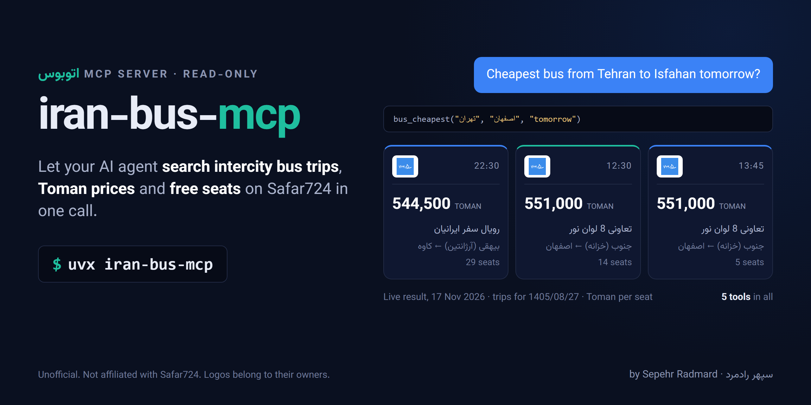

<!-- mcp-name: io.github.sepehr071/iran-bus-mcp -->

<div align="center">



# iran-bus-mcp: Iran bus tickets (بلیط اتوبوس) MCP server for AI agents, Safar724

**iran-bus-mcp is an unofficial, read-only MCP server that lets an AI agent search intercity bus trips, prices in Toman and free seats on Safar724 (سفر ۷۲۴, safar724.com), the Iranian bus ticket marketplace.**<br>
Its 5 tools look up cities, list the trips between two cities on a day, find the cheapest ticket, list terminals and companies on a route, and show the free seats and refund rules of one trip.<br>
No API key or account is needed; it works in Claude, Cursor, Copilot and any other MCP client.

[](https://pypi.org/project/iran-bus-mcp/)
[](https://pypi.org/project/iran-bus-mcp/)
[](https://github.com/sepehr071/iran-bus-mcp/actions/workflows/ci.yml)
[](https://github.com/sepehr071/iran-bus-mcp/blob/main/LICENSE)

[For AI agents](#for-ai-agents) · [Quick start](#quick-start) · [Tools](#tools) · [Limits](#limits) · [فارسی](#فارسی)

</div>

---

## For AI agents

- **What:** unofficial MCP server (model context protocol) for Iranian intercity bus tickets. Only Safar724 is covered today; every tool has a `provider` argument (`all` by default) so more ticket sites can join.
- **Install:** `uvx iran-bus-mcp` or `claude mcp add iran-bus -- uvx iran-bus-mcp`. Transport: stdio. Needs [uv](https://docs.astral.sh/uv/getting-started/installation/) (Python 3.10+).
- **Auth:** none. Optional `IRAN_BUS_MCP_PROXY` (HTTP proxy URL, or a comma-separated list); system proxy settings are ignored.
- **Access:** read-only. It cannot hold a seat, book or pay, and there is no login.
- **Tools:** 5, all prefixed `bus_`.
- **Use when:** the user asks which buses run between two Iranian cities on a day, what a ticket costs, which is the cheapest, which terminal it leaves from, or whether seats are left.
- **Output:** compact JSON. Prices are Toman per seat. Cities are Persian or English names; dates are Jalali (`1405/08/28`), Gregorian (`2026-11-19`), `today` or `tomorrow` (Tehran time). Company and bus-type text is Persian.

## Quick start

You need [uv](https://docs.astral.sh/uv/getting-started/installation/). No API key or account.

Claude Code:

```bash
claude mcp add iran-bus -- uvx iran-bus-mcp
```

Claude Desktop, Cursor, VS Code and other clients:

```json
{
  "mcpServers": {
    "iran-bus": { "command": "uvx", "args": ["iran-bus-mcp"] }
  }
}
```

Example prompts:

- "What is the cheapest bus from Tehran to Isfahan tomorrow?"
- "List bus trips from Tehran to Mashhad on 1405/08/30 and show free seats."
- "Which terminals do Tehran to Shiraz buses leave from?"
- <span dir="rtl">ارزان‌ترین بلیط اتوبوس تهران به اصفهان برای فردا کدام است؟</span>
- <span dir="rtl">اتوبوس‌های تهران به تبریز در روز ۳۰ آبان را با قیمت و صندلی خالی نشان بده.</span>

A real answer (`bus_cheapest`, Tehran to Isfahan, 17 Nov 2026 for 1405/08/27): the cheapest trip was 544,500 Toman at 22:30 with Royal Safar Iranian (رویال سفر ایرانیان), 29 seats free, from the Beyhaghi (Argentina) terminal; next were two 551,000 Toman trips at 12:30 and 13:45 from the southern terminal (Khazaneh). Prices and seats change as tickets sell.

## Tools

| Tool | What it does |
|---|---|
| `bus_cities` | Look up cities (name, code, province) that tickets can be bought for; use it to spell a city exactly. |
| `bus_search` | List bus trips between two cities on one day: time, company, bus type, price in Toman, free seats, terminals. |
| `bus_cheapest` | Cheapest bus trips between two cities on one day, merged across providers and sorted by price in Toman. |
| `bus_terminals` | List the departure and arrival terminals that have trips on a route and the companies running them. |
| `bus_trip` | Seat map summary and refund penalties of one trip: free seat numbers, seats taken by men or women. |

## Limits

- Only Safar724 works. payaneh.ir (پایانه) is not supported.
- Trips come only for days Safar724 sells; a past date is refused. Trips that continue past the destination are listed with their `via` city.
- The site's VIP flag is unreliable, so VIP is read from the bus-type text.
- Prices and free seats are a snapshot. Booking and payment happen on safar724.com.
- Works from Iranian and foreign networks (tested from both). Set `IRAN_BUS_MCP_PROXY` if your network blocks it; the server ignores system proxy variables on purpose.

## فارسی

<div dir="rtl">

iran-bus-mcp یک سرور MCP غیررسمی و فقط‌خواندنی است که به ایجنت هوش مصنوعی اجازه می‌دهد سفرهای اتوبوس بین‌شهری، قیمت به تومان و صندلی‌های خالی را در سفر ۷۲۴ (safar724.com) جست‌وجو کند. ارزان‌ترین بلیط، پایانه‌ها و شرکت‌های یک مسیر و نقشهٔ صندلی هر سفر را می‌دهد. رزرو و پرداخت ندارد. سایت پایانه (payaneh.ir) فعلاً پشتیبانی نمی‌شود. نصب در Claude Code:

</div>

```bash
claude mcp add iran-bus -- uvx iran-bus-mcp
```

## Development

```bash
uv sync
uv run ruff check . && uv run ruff format --check .
uv run python -m pytest -q          # offline tests on recorded fixtures
uv run python -m pytest -m live -q  # live calls to Safar724
```

Releases: bump the version in `pyproject.toml` and `server.json`, run `uv lock`, then push a `v*` tag; GitHub Actions publishes to PyPI.

## Disclaimer

Unofficial and not affiliated with or endorsed by Safar724. It is read-only and uses the public pages and API of that site, which can change without notice.

## Author

Built and maintained by **Sepehr Radmard** (سپهر رادمرد). [LinkedIn](https://www.linkedin.com/in/sepehr-radmard) · [GitHub](https://github.com/sepehr071) · more servers in [iran-mcp](https://github.com/sepehr071/iran-mcp).

## مجوز استفاده (License)

<a href="https://www.linkedin.com/in/sepehr-radmard"></a>

**استفادهٔ شخصی و غیرتجاری رایگان است.** استفاده در شرکت، محصول پولی یا پروژهٔ مشتری به مجوز تجاری نیاز دارد؛ از راه [لینکدین](https://www.linkedin.com/in/sepehr-radmard) یا [گیت&zwnj;هاب](https://github.com/sepehr071) با سپهر رادمرد تماس بگیرید. متن کامل: [PolyForm Noncommercial 1.0.0](https://github.com/sepehr071/iran-bus-mcp/blob/main/LICENSE). نسخه&zwnj;های پیش از 0.1.1 با مجوز MIT منتشر شده&zwnj;اند و همان مجوز را دارند.

Free for personal and non-commercial use under the [PolyForm Noncommercial License 1.0.0](https://github.com/sepehr071/iran-bus-mcp/blob/main/LICENSE). Using it in a company, a paid product or a client project needs a commercial license: contact Sepehr Radmard on [LinkedIn](https://www.linkedin.com/in/sepehr-radmard) or [GitHub](https://github.com/sepehr071). Versions before 0.1.1 were released under MIT and stay under it.
